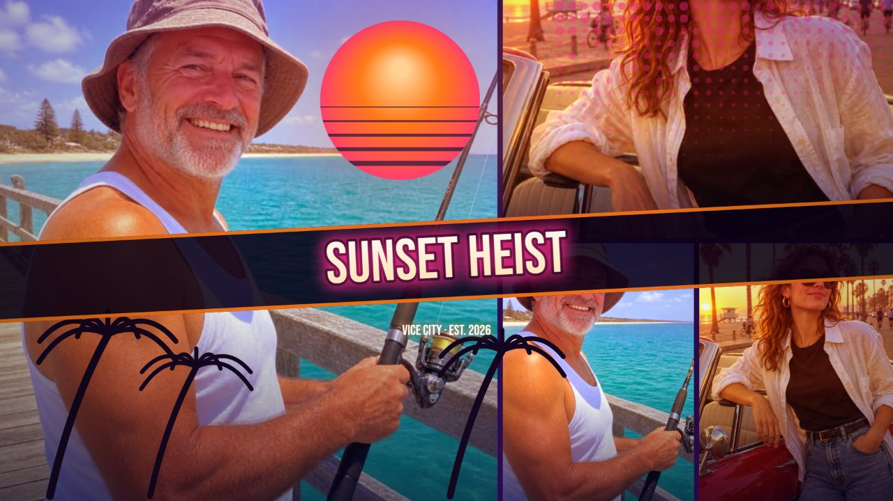
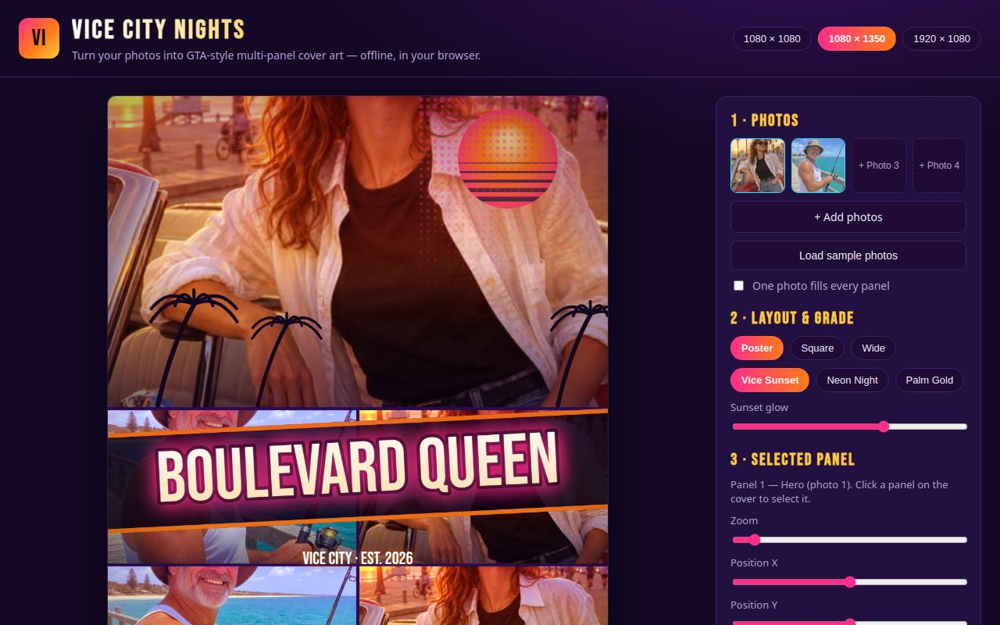
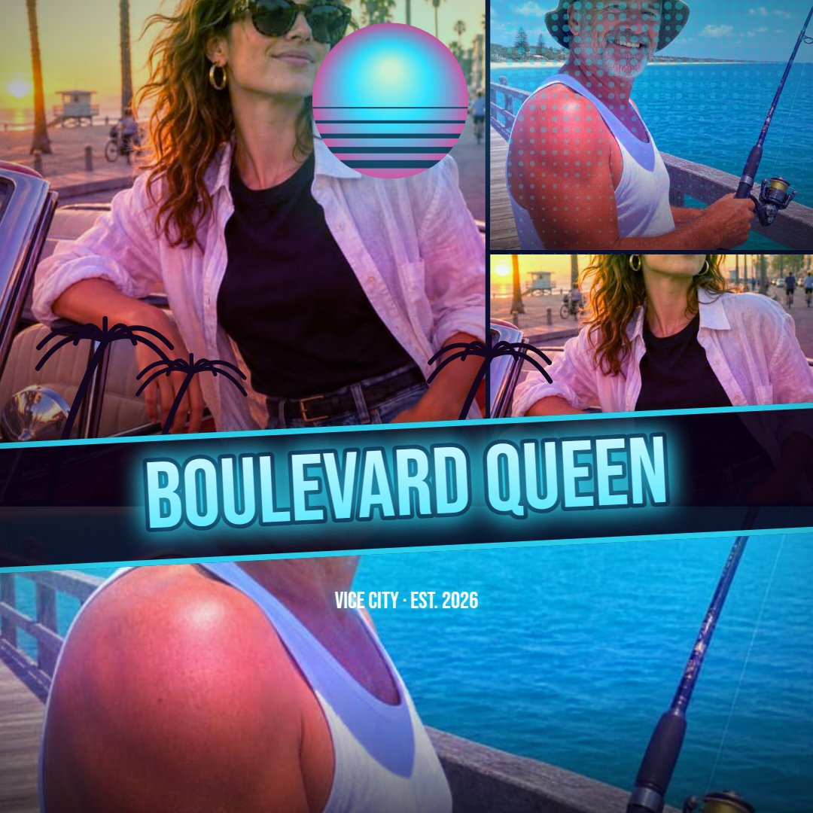
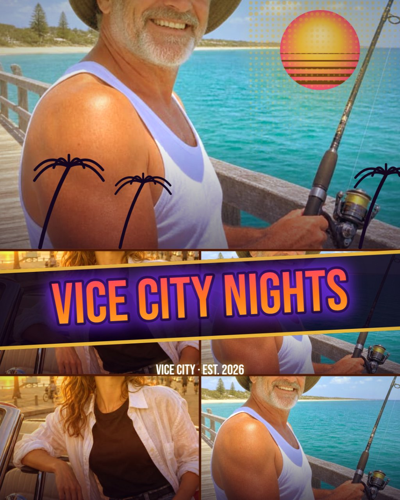

# gta6-cover-art

[](https://make.fun/bounty/gta6-cover-art-01?utm_source=github&utm_medium=readme&utm_campaign=gta6-cover-art-01)
[](https://make.fun/bounty/gta6-cover-art-01/leaderboard?utm_source=github&utm_medium=readme&utm_campaign=gta6-cover-art-01)
[](https://make.fun/bounty/gta6-cover-art-01?utm_source=github&utm_medium=readme&utm_campaign=gta6-cover-art-01)

**Vice City Nights** — an offline web app that turns your photo and a
caption into GTA 6-style multi-panel cover art and exports it as a PNG.

Load up to four of your own photos (or the two bundled samples), drop
them into the poster, square or wide layout, pick a colour grade — Vice
Sunset, Neon Night or Palm Gold — slide the sunset glow, crop and position
each panel by dragging, write your title and subtitle, and export a
1080×1080, 1080×1350 or 1920×1080 PNG ready to post. The cover is drawn
entirely in code: retro sun with slits, palm silhouettes, halftone dots,
grain and a tilted title ribbon. Photos are read on your machine and never
uploaded; the app makes no network request at all.

## Run it

```sh
node serve.ts
```

Then open http://localhost:8080

No build step, no dependencies — plain static files under `app/`.

## Screenshots






## Notes

- Original art only: no Rockstar Games logo, wordmark, official artwork,
  character or font. The display font is Bebas Neue (SIL OFL 1.1, see
  `app/fonts/FONT-LICENSE.txt`).
- Sample photos are free to use and ship with the app.

---

Built for the make.fun bounty
[gta6-cover-art-01](https://make.fun/bounty/gta6-cover-art-01?ref=davidwara).
